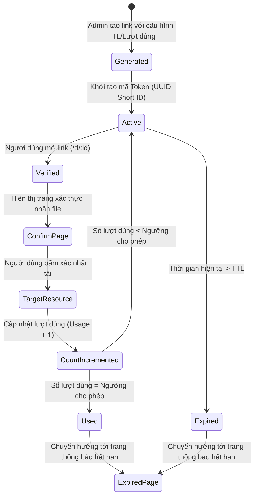

# ⏳ Link-Temporary — Hệ Thống Quản Lý & Phân Phối Link Sử Dụng Giới Hạn

[](https://nodejs.org/)
[](LICENSE)
[](https://vercel.com)

**Link-Temporary** là giải pháp phần mềm cho phép tạo, quản lý và kiểm soát quyền truy cập liên kết với các quy tắc nghiệp vụ nghiêm ngặt: **giới hạn số lượt truy cập (usage limit)**, **thời gian sống (TTL - Time to live)** và **mã hóa bảo mật token truy cập**. Hệ thống phù hợp cho việc phân phối tài nguyên nhạy cảm (tài liệu nội bộ, link tải phần mềm, coupon dùng một lần).

---

## 🎯 Bài Toán Nghiệp Vụ & Giải Pháp (Business Problem & Solution)

| Thách thức thực tế | Giải pháp kỹ thuật trong Link-Temporary |
|---|---|
| Link tài nguyên bị chia sẻ công khai, rò rỉ ra bên ngoài | Mỗi liên kết tạo ra chỉ có hiệu lực với số lượt dùng cố định (mặc định 1 lần) |
| Người dùng truy cập lại link cũ đã hết hạn sử dụng | Cơ chế kiểm tra trạng thái thời gian thực (`Active` ➔ `Used` ➔ `Expired`) |
| Tải file tự động không mong muốn hoặc bot cào link | Màn hình trung gian xác thực (Confirmation page) trước khi chuyển hướng tới URL đích |
| Khó quản lý và theo dõi lượt tải | Bảng điều khiển (Generator Dashboard) giám sát trạng thái từng link |

---

## 🏗️ Luồng Xử Lý Hệ Thống (Workflow & State Diagram)



---

## 🚀 Các Tính Năng Cốt Lõi

1. **Sinh Token Ngẫu Nhiên An Toàn:** Tạo định danh duy nhất (Short UUID) không thể đoán trước, ngăn chặn brute-force link.
2. **Kiểm Soát Vòng Đời Liên Kết (Lifecycle Control):**
   - Hỗ trợ thiết lập link 1 lần dùng (One-time download).
   - Thiết lập thời gian sống (TTL): Tự động vô hiệu hóa sau khoảng thời gian quy định.
3. **Màn Hình Điều Hướng Thân Thiện:**
   - `generator.html`: Bảng điều khiển quản lý và tạo link nhanh.
   - `confirm.html`: Màn hình xác thực và đếm ngược trước khi chuyển tiếp.
   - `expired.html`: Giao diện báo lỗi thân thiện giải thích rõ lý do link không còn khả dụng.
4. **Hỗ Trợ Đa Môi Trường:** Chạy trơn tru trên cả máy chủ độc lập (**Express.js**) hoặc triển khai không máy chủ (**Vercel Serverless Functions**).

---

## 📡 Đặc Tả API (API Specifications)

### 1. Lấy cấu hình hệ thống
- **Endpoint:** `GET /api/config`
- **Response:**
  ```json
  {
    "githubUrl": "https://github.com/dungnguyen0537/..."
  }
  ```

### 2. Cập nhật cấu hình URL gốc
- **Endpoint:** `POST /api/config`
- **Headers:** `Content-Type: application/json`
- **Body:**
  ```json
  {
    "githubUrl": "https://github.com/user/project/releases/..."
  }
  ```

### 3. Tạo link sử dụng có giới hạn
- **Endpoint:** `POST /api/create-link`
- **Response:**
  ```json
  {
    "success": true,
    "link": {
      "id": "e4b9a1c2",
      "createdAt": "2026-11-04T16:00:00.000Z",
      "used": false,
      "usedAt": null
    },
    "fullUrl": "https://your-domain.com/d/e4b9a1c2"
  }
  ```

### 4. Truy cập liên kết tạm thời
- **Endpoint:** `GET /d/:id`
- **Mô tả:** Kiểm tra tính hợp lệ của Token `id`:
  - Nếu hợp lệ: Trả về trang `confirm.html` để tiếp tục luồng nhận file.
  - Nếu không tồn tại hoặc đã hết hạn: Chuyển hướng tới `expired.html`.

---

## 🛠️ Hướng Dẫn Cài Đặt & Triển Khai

### 1. Chạy trên môi trường Local (Node.js)
```bash
# 1. Cài đặt thư viện phụ thuộc
npm install

# 2. Khởi chạy server
npm start
# Server chạy mặc định tại http://localhost:3000
```

### 2. Triển khai lên Vercel
Dự án đã tích hợp sẵn tệp cấu hình `vercel.json` phục vụ Serverless Function:
```bash
npm install -g vercel
vercel deploy
```

---

## 🔒 Quy Tắc Bảo Mật & Non-Functional Requirements (NFR)
- **Data Integrity:** Dữ liệu token được xác thực tính toàn vẹn trước mỗi lần phân giải URL.
- **Fail-Safe Default:** Mọi yêu cầu không hợp lệ hoặc dữ liệu không tồn tại đều chuyển hướng an toàn về trang báo lỗi, không làm lộ stack trace hoặc cấu trúc máy chủ.
- **Performance:** Thời gian phản hồi phân giải token < 50ms.

---

## 👤 Tác Giả & Liên Hệ
- **Nguyễn Văn Dũng** (HaUI - Information Systems)
- **GitHub:** [@dungnguyen0537](https://github.com/dungnguyen0537)
- **Email:** dungnguyen120737@gmail.com
